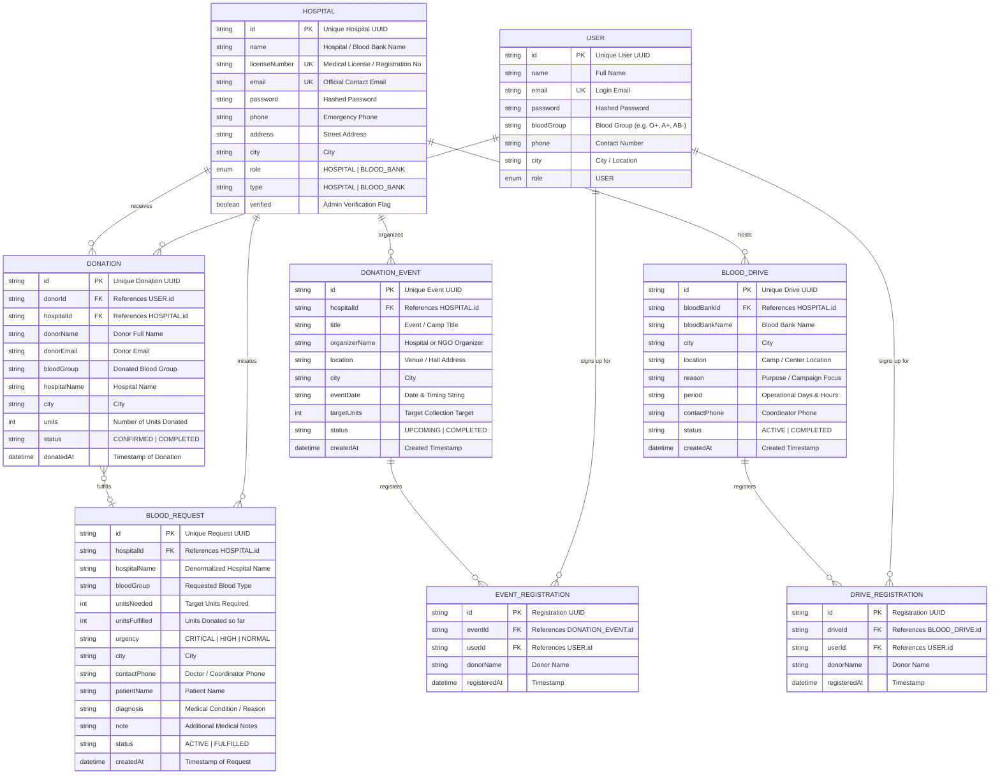

# Entity-Relationship (ER) Diagram & Schema Specification
## Blood Donation & Event Management Portal (`3rdSemCEP`)

---

## 1. Conceptual & Logical ER Diagram (Mermaid)



---

## 2. Entity Details & Data Dictionary

### 1. `USER` Entity (Donors / General Citizens)
Represents voluntary blood donors registered on the platform.
* **`id`** (`String` / `VARCHAR(36)`): **Primary Key**. UUID generated upon registration.
* **`name`** (`String` / `VARCHAR(100)`): Full name of the donor.
* **`email`** (`String` / `VARCHAR(120)`): **Unique**, not null. Used for login authentication.
* **`password`** (`String` / `VARCHAR(255)`): Hashed credentials.
* **`bloodGroup`** (`String` / `VARCHAR(5)`): Blood group (e.g., `A+`, `A-`, `B+`, `B-`, `AB+`, `AB-`, `O+`, `O-`).
* **`phone`** (`String` / `VARCHAR(20)`): Contact phone number for urgent notifications.
* **`city`** (`String` / `VARCHAR(60)`): City for geographical matching with nearby blood requests and drives.
* **`role`** (`Role` / `VARCHAR(20)`): User role (defaults to `USER`).

---

### 2. `HOSPITAL` Entity (Hospitals & Blood Banks)
Represents verified medical institutions and licensed blood banks.
* **`id`** (`String` / `VARCHAR(36)`): **Primary Key**. UUID assigned at registration.
* **`name`** (`String` / `VARCHAR(150)`): Official institution name.
* **`licenseNumber`** (`String` / `VARCHAR(80)`): **Unique**, verified regulatory medical license number.
* **`email`** (`String` / `VARCHAR(120)`): **Unique**. Official login email.
* **`password`** (`String` / `VARCHAR(255)`): Hashed institution password.
* **`phone`** (`String` / `VARCHAR(20)`): 24/7 blood bank / emergency contact line.
* **`address`** (`String` / `VARCHAR(255)`): Physical hospital address.
* **`city`** (`String` / `VARCHAR(60)`): Operating city.
* **`role`** (`Role` / `VARCHAR(20)`): Institutional role (`HOSPITAL` or `BLOOD_BANK`).
* **`type`** (`String` / `VARCHAR(20)`): Discriminator flag (`"HOSPITAL"` | `"BLOOD_BANK"`).
* **`verified`** (`Boolean`): Administrative verification flag (enables posting trusted drives).

---

### 3. `BLOOD_REQUEST` Entity (Urgent Patient Blood Requisitions)
Created by hospitals when patients require blood for surgeries, emergency trauma, or critical care.
* **`id`** (`String` / `VARCHAR(36)`): **Primary Key**.
* **`hospitalId`** (`String` / `VARCHAR(36)`): **Foreign Key** $\to$ `HOSPITAL.id`.
* **`hospitalName`** (`String` / `VARCHAR(150)`): Denormalized hospital name for low-latency queries.
* **`bloodGroup`** (`String` / `VARCHAR(5)`): Requested blood group (`O+`, `B-`, etc.).
* **`unitsNeeded`** (`Integer`): Total volume units needed (e.g., 2, 4 units).
* **`unitsFulfilled`** (`Integer`): Current quantity fulfilled by donors (auto-increments upon confirmed donation).
* **`urgency`** (`String` / `VARCHAR(20)`): Priority badge (`"CRITICAL"` | `"HIGH"` | `"NORMAL"`).
* **`city`** (`String` / `VARCHAR(60)`): City where blood is required.
* **`contactPhone`** (`String` / `VARCHAR(20)`): Direct medical department phone.
* **`patientName`** (`String` / `VARCHAR(100)`): Patient name.
* **`diagnosis`** (`String` / `VARCHAR(255)`): Diagnosis / clinical reason (e.g. "Severe Anemia", "Cardiac Surgery").
* **`note`** (`String` / `TEXT`): Additional clinical notes and instructions.
* **`status`** (`String` / `VARCHAR(20)`): Lifecycle status (`"ACTIVE"` $\to$ `"FULFILLED"`).
* **`createdAt`** (`LocalDateTime`): Timestamp of creation.

---

### 4. `DONATION` Entity (Completed / Confirmed Donations)
Acts as the transaction and associative entity linking voluntary donors to hospitals and active requests.
* **`id`** (`String` / `VARCHAR(36)`): **Primary Key**.
* **`donorId`** (`String` / `VARCHAR(36)`): **Foreign Key** $\to$ `USER.id`.
* **`hospitalId`** (`String` / `VARCHAR(36)`): **Foreign Key** $\to$ `HOSPITAL.id`.
* **`donorName`** (`String` / `VARCHAR(100)`): Name of the donor.
* **`donorEmail`** (`String` / `VARCHAR(120)`): Donor email for acknowledgment/certificates.
* **`bloodGroup`** (`String` / `VARCHAR(5)`): Donated blood group.
* **`hospitalName`** (`String` / `VARCHAR(150)`): Receiving hospital name.
* **`city`** (`String` / `VARCHAR(60)`): City where donation took place.
* **`units`** (`Integer`): Number of blood units donated (typically 1).
* **`status`** (`String` / `VARCHAR(20)`): `"CONFIRMED"` | `"COMPLETED"`.
* **`donatedAt`** (`LocalDateTime`): Date and time of donation.

---

### 5. `DONATION_EVENT` Entity (Hospital & Community Blood Camps)
Organized blood donation camps hosted by hospitals, colleges, or civic institutions.
* **`id`** (`String` / `VARCHAR(36)`): **Primary Key**.
* **`hospitalId`** (`String` / `VARCHAR(36)`): **Foreign Key** $\to$ `HOSPITAL.id` (optional organizer).
* **`title`** (`String` / `VARCHAR(150)`): Event title (e.g. "Annual DBIT Campus Blood Drive").
* **`organizerName`** (`String` / `VARCHAR(120)`): Organizing institution or NGO.
* **`location`** (`String` / `VARCHAR(255)`): Campus hall / community center venue.
* **`city`** (`String` / `VARCHAR(60)`): City of event.
* **`eventDate`** (`String` / `VARCHAR(80)`): Date & timing slot.
* **`targetUnits`** (`Integer`): Target collection units (e.g. 150 units).
* **`registeredDonors`** (`List<String>`): List of registered donor identifiers.
* **`status`** (`String` / `VARCHAR(20)`): `"UPCOMING"` | `"COMPLETED"`.
* **`createdAt`** (`LocalDateTime`): Creation timestamp.

---

### 6. `BLOOD_DRIVE` Entity (Blood Bank Collection Drives)
Public collection drives organized specifically by licensed Blood Banks.
* **`id`** (`String` / `VARCHAR(36)`): **Primary Key**.
* **`bloodBankId`** (`String` / `VARCHAR(36)`): **Foreign Key** $\to$ `HOSPITAL.id`.
* **`bloodBankName`** (`String` / `VARCHAR(150)`): Blood Bank name.
* **`city`** (`String` / `VARCHAR(60)`): City.
* **`location`** (`String` / `VARCHAR(255)`): Venue location.
* **`reason`** (`String` / `VARCHAR(255)`): Focus campaign (e.g., "Pre-Monsoon Platelet Stocking").
* **`period`** (`String` / `VARCHAR(80)`): Dates and operational hours.
* **`contactPhone`** (`String` / `VARCHAR(20)`): Drive coordinator phone.
* **`registeredDonors`** (`List<String>`): Registered donor list.
* **`status`** (`String` / `VARCHAR(20)`): `"ACTIVE"` | `"COMPLETED"`.
* **`createdAt`** (`LocalDateTime`): Creation timestamp.

---

## 3. Relationships & Cardinality Table

| Relationship | Type | Cardinality | Explanation |
| :--- | :---: | :---: | :--- |
| **HOSPITAL $\to$ BLOOD_REQUEST** | One-to-Many | $1 : N$ | One hospital can initiate multiple blood requests over time; each request belongs strictly to one hospital. |
| **USER $\to$ DONATION** | One-to-Many | $1 : N$ | One registered user/donor can donate multiple times ($N$); each donation record belongs to one donor. |
| **HOSPITAL $\to$ DONATION** | One-to-Many | $1 : N$ | One hospital receives donations from multiple donors; each donation is received at one specific facility. |
| **DONATION $\to$ BLOOD_REQUEST** | Many-to-One (Optional) | $N : 0..1$ | Multiple individual donations can be linked to fulfill an active request until `unitsFulfilled >= unitsNeeded`. |
| **HOSPITAL $\to$ DONATION_EVENT** | One-to-Many | $1 : N$ | A hospital or medical body organizes multiple community camps. |
| **HOSPITAL (Blood Bank) $\to$ BLOOD_DRIVE** | One-to-Many | $1 : N$ | A blood bank organizes multiple seasonal collection drives. |
| **USER $\leftrightarrow$ DONATION_EVENT** | Many-to-Many | $M : N$ | Users can sign up for multiple camps; each camp collects registrations from multiple users. |
| **USER $\leftrightarrow$ BLOOD_DRIVE** | Many-to-Many | $M : N$ | Donors can register for multiple blood drives; each drive enrolls multiple donors. |

---

## 4. Relational Schema (Normalized - 3NF / BCNF)

For relational database implementation (e.g. PostgreSQL / MySQL / H2):

```sql
-- 1. Users Table (Donors)
CREATE TABLE users (
    id VARCHAR(36) PRIMARY KEY,
    name VARCHAR(100) NOT NULL,
    email VARCHAR(120) NOT NULL UNIQUE,
    password VARCHAR(255) NOT NULL,
    blood_group VARCHAR(5) NOT NULL,
    phone VARCHAR(20) NOT NULL,
    city VARCHAR(60) NOT NULL,
    role VARCHAR(20) NOT NULL DEFAULT 'USER'
);

-- 2. Hospitals and Blood Banks Table
CREATE TABLE hospitals (
    id VARCHAR(36) PRIMARY KEY,
    name VARCHAR(150) NOT NULL,
    license_number VARCHAR(80) NOT NULL UNIQUE,
    email VARCHAR(120) NOT NULL UNIQUE,
    password VARCHAR(255) NOT NULL,
    phone VARCHAR(20) NOT NULL,
    address VARCHAR(255) NOT NULL,
    city VARCHAR(60) NOT NULL,
    role VARCHAR(20) NOT NULL DEFAULT 'HOSPITAL',
    type VARCHAR(20) NOT NULL DEFAULT 'HOSPITAL',
    verified BOOLEAN NOT NULL DEFAULT FALSE
);

-- 3. Blood Requests Table
CREATE TABLE blood_requests (
    id VARCHAR(36) PRIMARY KEY,
    hospital_id VARCHAR(36) NOT NULL,
    hospital_name VARCHAR(150) NOT NULL,
    blood_group VARCHAR(5) NOT NULL,
    units_needed INT NOT NULL CHECK (units_needed > 0),
    units_fulfilled INT NOT NULL DEFAULT 0,
    urgency VARCHAR(20) NOT NULL DEFAULT 'NORMAL',
    city VARCHAR(60) NOT NULL,
    contact_phone VARCHAR(20) NOT NULL,
    patient_name VARCHAR(100),
    diagnosis VARCHAR(255),
    note TEXT,
    status VARCHAR(20) NOT NULL DEFAULT 'ACTIVE',
    created_at TIMESTAMP NOT NULL DEFAULT CURRENT_TIMESTAMP,
    CONSTRAINT fk_request_hospital FOREIGN KEY (hospital_id) REFERENCES hospitals(id) ON DELETE CASCADE
);

-- 4. Donations Table (Associative Transaction Record)
CREATE TABLE donations (
    id VARCHAR(36) PRIMARY KEY,
    donor_id VARCHAR(36),
    hospital_id VARCHAR(36) NOT NULL,
    donor_name VARCHAR(100) NOT NULL,
    donor_email VARCHAR(120),
    blood_group VARCHAR(5) NOT NULL,
    hospital_name VARCHAR(150) NOT NULL,
    city VARCHAR(60) NOT NULL,
    units INT NOT NULL DEFAULT 1 CHECK (units > 0),
    status VARCHAR(20) NOT NULL DEFAULT 'CONFIRMED',
    donated_at TIMESTAMP NOT NULL DEFAULT CURRENT_TIMESTAMP,
    CONSTRAINT fk_donation_user FOREIGN KEY (donor_id) REFERENCES users(id) ON DELETE SET NULL,
    CONSTRAINT fk_donation_hospital FOREIGN KEY (hospital_id) REFERENCES hospitals(id) ON DELETE CASCADE
);

-- 5. Donation Events Table (Camps)
CREATE TABLE donation_events (
    id VARCHAR(36) PRIMARY KEY,
    hospital_id VARCHAR(36),
    title VARCHAR(150) NOT NULL,
    organizer_name VARCHAR(120) NOT NULL,
    location VARCHAR(255) NOT NULL,
    city VARCHAR(60) NOT NULL,
    event_date VARCHAR(80) NOT NULL,
    target_units INT NOT NULL DEFAULT 100,
    status VARCHAR(20) NOT NULL DEFAULT 'UPCOMING',
    created_at TIMESTAMP NOT NULL DEFAULT CURRENT_TIMESTAMP,
    CONSTRAINT fk_event_hospital FOREIGN KEY (hospital_id) REFERENCES hospitals(id) ON DELETE SET NULL
);

-- 6. Blood Drives Table
CREATE TABLE blood_drives (
    id VARCHAR(36) PRIMARY KEY,
    blood_bank_id VARCHAR(36) NOT NULL,
    blood_bank_name VARCHAR(150) NOT NULL,
    city VARCHAR(60) NOT NULL,
    location VARCHAR(255) NOT NULL,
    reason VARCHAR(255),
    period VARCHAR(80) NOT NULL,
    contact_phone VARCHAR(20) NOT NULL,
    status VARCHAR(20) NOT NULL DEFAULT 'ACTIVE',
    created_at TIMESTAMP NOT NULL DEFAULT CURRENT_TIMESTAMP,
    CONSTRAINT fk_drive_bloodbank FOREIGN KEY (blood_bank_id) REFERENCES hospitals(id) ON DELETE CASCADE
);

-- 7. Event Registrations (Junction Table for M:N User <-> DonationEvent)
CREATE TABLE event_registrations (
    id VARCHAR(36) PRIMARY KEY,
    event_id VARCHAR(36) NOT NULL,
    user_id VARCHAR(36),
    donor_name VARCHAR(100) NOT NULL,
    registered_at TIMESTAMP NOT NULL DEFAULT CURRENT_TIMESTAMP,
    CONSTRAINT fk_reg_event FOREIGN KEY (event_id) REFERENCES donation_events(id) ON DELETE CASCADE,
    CONSTRAINT fk_reg_user FOREIGN KEY (user_id) REFERENCES users(id) ON DELETE SET NULL
);

-- 8. Drive Registrations (Junction Table for M:N User <-> BloodDrive)
CREATE TABLE drive_registrations (
    id VARCHAR(36) PRIMARY KEY,
    drive_id VARCHAR(36) NOT NULL,
    user_id VARCHAR(36),
    donor_name VARCHAR(100) NOT NULL,
    registered_at TIMESTAMP NOT NULL DEFAULT CURRENT_TIMESTAMP,
    CONSTRAINT fk_dreg_drive FOREIGN KEY (drive_id) REFERENCES blood_drives(id) ON DELETE CASCADE,
    CONSTRAINT fk_dreg_user FOREIGN KEY (user_id) REFERENCES users(id) ON DELETE SET NULL
);
```

